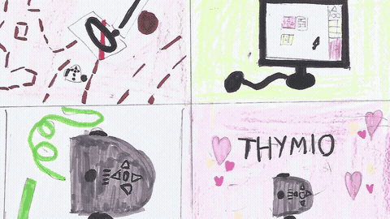

# Atelier-5 · .github

🇬🇧 This repository holds the landing page of the [Atelier-5 organisation](https://github.com/Atelier-5) and its shared GitHub settings.
🇫🇷 Ce dépôt contient la page d'accueil de l'[organisation Atelier-5](https://github.com/Atelier-5) et ses réglages GitHub communs.
🇩🇪 Dieses Repository enthält die Startseite der [Organisation Atelier-5](https://github.com/Atelier-5) und ihre gemeinsamen GitHub-Einstellungen.

| | |
|---|---|
| [`profile/README.md`](profile/README.md) | The landing page shown on [github.com/Atelier-5](https://github.com/Atelier-5) |
| [Atelier-5/atl-hub](https://github.com/Atelier-5/atl-hub) | Brand, Native Agile pedagogy, activity cards |
| [Atelier-5/atl-sim](https://github.com/Atelier-5/atl-sim) | Webots worlds: the Thymio fleet on a challenge table |

## Meet and Code: drawing Thymio

🇬🇧 After a Meet and Code workshop with Thymio II, the children drew their robots: mazes, tracks, sensors, and Thymio dreaming of a computer.
🇫🇷 Après un atelier Meet and Code avec Thymio II, les enfants ont dessiné leurs robots : labyrinthes, pistes, capteurs, et Thymio qui rêve d'un ordinateur.
🇩🇪 Nach einem Meet-and-Code-Workshop mit Thymio II haben die Kinder ihre Roboter gezeichnet: Labyrinthe, Strecken, Sensoren und Thymio, der von einem Computer träumt.

 
▶ <a href="media/meet-and-code-thymio-drawings.mp4">Watch the 27 s video</a> · « Programmer, c'est donner la vie au robot »

GPL-3.0-or-later. The name "Atelier-5" and its logos are reserved, see <a href="https://github.com/Atelier-5/atl-hub/blob/main/TRADEMARKS.md">TRADEMARKS</a>.
