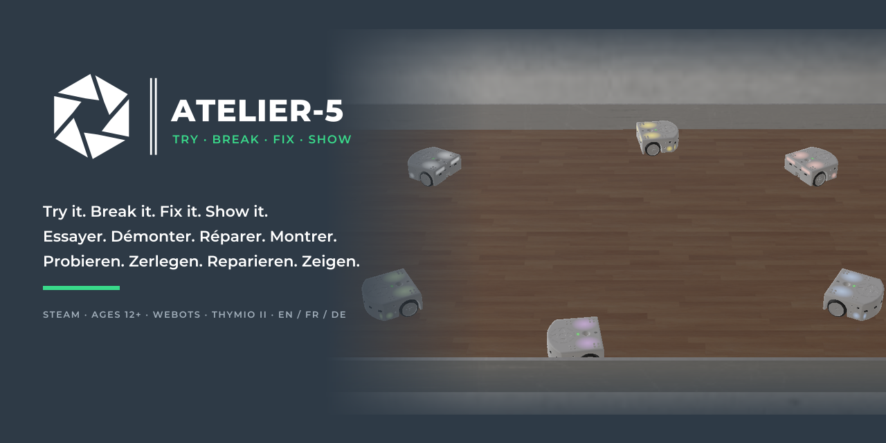

# Atelier-5 · .github

🇬🇧 This repository holds the landing page of the [Atelier-5 organisation](https://github.com/Atelier-5) and its shared GitHub settings.
🇫🇷 Ce dépôt contient la page d'accueil de l'[organisation Atelier-5](https://github.com/Atelier-5) et ses réglages GitHub communs.
🇩🇪 Dieses Repository enthält die Startseite der [Organisation Atelier-5](https://github.com/Atelier-5) und ihre gemeinsamen GitHub-Einstellungen.

| | |
|---|---|
| [`profile/README.md`](profile/README.md) | The landing page shown on [github.com/Atelier-5](https://github.com/Atelier-5) |
| [Atelier-5/atl-hub](https://github.com/Atelier-5/atl-hub) | Brand, Native Agile pedagogy, activity cards |

GPL-3.0-or-later. The name "Atelier-5" and its logos are reserved, see <a href="https://github.com/Atelier-5/atl-hub/blob/main/TRADEMARKS.md">TRADEMARKS</a>.
