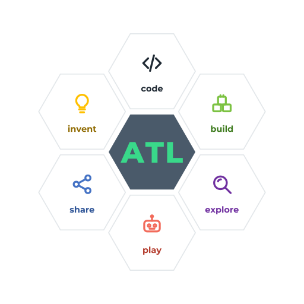

🇬🇧 <b>Try it. Break it. Fix it. Show it.</b> 
🇫🇷 <b>Essayer. Démonter. Réparer. Montrer.</b> 
🇩🇪 <b>Probieren. Zerlegen. Reparieren. Zeigen.</b>

🇬🇧 **Atelier-5** is a STEAM workshop for ages 12 and up, and for the parents and teachers who want to try it with them. Inspired by Freinet, and also by Papert, Montessori and Dewey. Learners try ideas in **Webots** simulation first, then on real robots. AI is a *correspondant*: a pen-pal that asks questions before it suggests anything. Atelier-5 is a project, not a school, and everything here is open.

🇫🇷 **Atelier-5** est un atelier STEAM dès 12 ans, ainsi que pour les parents et les enseignants qui veulent l'essayer avec eux. Inspiré par Freinet, et aussi par Papert, Montessori et Dewey. On essaie d'abord en simulation **Webots**, puis sur de vrais robots. L'IA est un *correspondant* qui pose des questions avant de proposer quoi que ce soit. Atelier-5 est un projet, pas une école, et tout ici est ouvert.

🇩🇪 **Atelier-5** ist eine MINT-Werkstatt ab 12 Jahren, und für Eltern und Lehrkräfte, die sie gemeinsam mit ihnen ausprobieren wollen. Inspiriert von Freinet, außerdem von Papert, Montessori und Dewey. Ideen werden zuerst in der **Webots**-Simulation ausprobiert, dann mit echten Robotern. Die KI ist ein *Brieffreund*, der Fragen stellt, bevor er etwas vorschlägt. Atelier-5 ist ein Projekt, keine Schule, und alles hier ist offen.

| | |
|---|---|
| [**atl-hub**](https://github.com/Atelier-5/atl-hub) | Brand, Native Agile pedagogy, activity cards · Identité, pédagogie, fiches · Marke, Pädagogik, Karten |
| **atl-sim** *(coming soon)* | Webots worlds: the Thymio fleet on a challenge table · Mondes Webots · Webots-Welten |

Atelier-5 is the education branch of D-LAB-5 and continues the earlier project Autre TechLab. Code and content: GPL-3.0-or-later; the name and logos are reserved (see <a href="https://github.com/Atelier-5/atl-hub/blob/main/TRADEMARKS.md">TRADEMARKS</a>).
